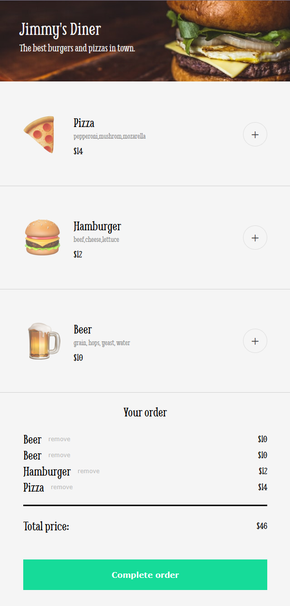

# Restaurant Order App

An ordering page for a fictional diner. Pick items from the menu, review your
order with a running total, and complete it through a card details form.

Built as a solo project in [Scrimba's Fullstack Developer Path](https://scrimba.com/fullstack-path-c0fullstack).



## Features

- **Menu rendered from data**: items come from a JavaScript array, not hard-coded HTML
- **Order summary**: add items, remove them individually, and see the total update instantly
- **Checkout modal** with a card details form validated in HTML (required fields, 16-digit card number, 3-digit CCV)
- **Confirmation message** after the order is placed

## Built with

- JavaScript (ES modules, `map`, `find`, `reduce`, event delegation with `data-*` attributes)
- HTML forms with built-in validation
- CSS

## What I learned

- Keeping the UI in sync with state: the cart is an array, and every change re-renders the order summary from it
- Calculating totals with `reduce`
- Handling clicks for many buttons with a single event listener and `data-*` attributes

## Next steps

- [ ] Close button for confirm order
- [ ] Group repeated items in the order (e.g. "Pizza ×2")
- [ ] Add a discount for meal deals

## Run locally

```bash
git clone https://github.com/wzolnierek/restaurant-order-app.git
cd restaurant-order-app
npm install
npm start
```
